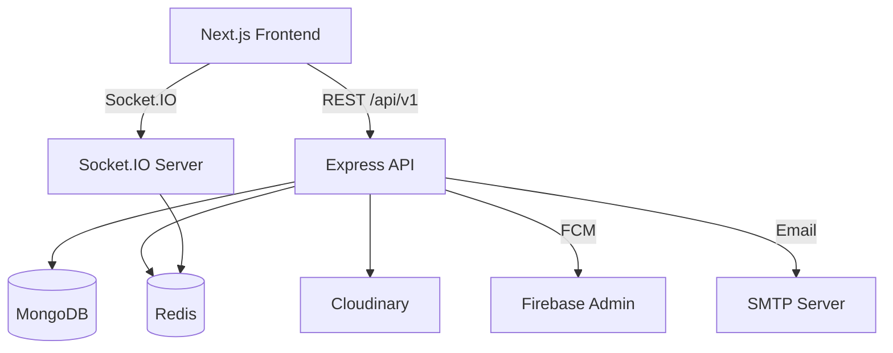
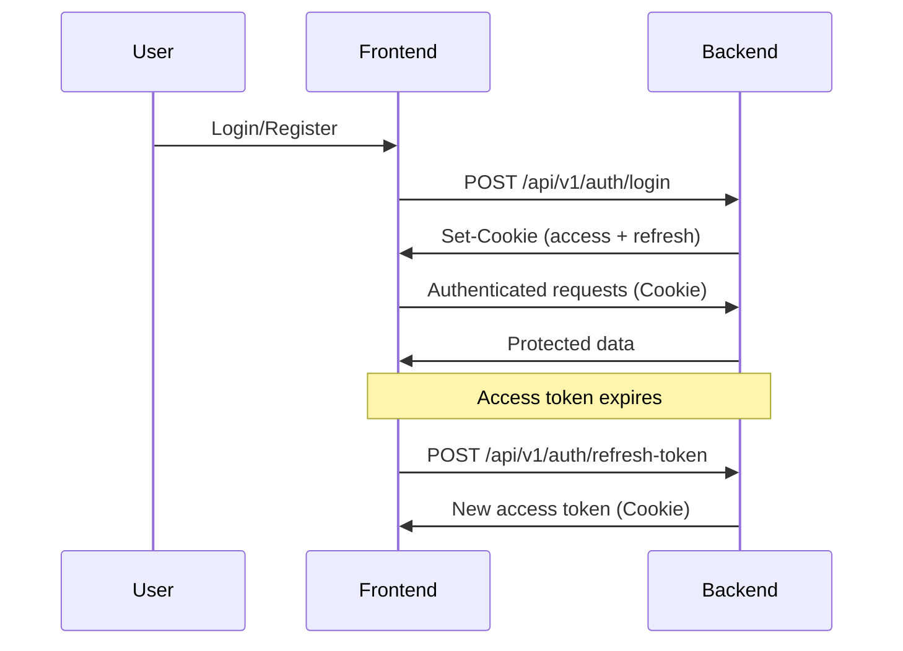

# Talkify — Social Media Platform

A modern, full-stack social media application built with **Next.js 16 (App Router)**, **React 19**, **TypeScript**, **Socket.IO**, and **MongoDB**. Talkify provides real-time messaging, social networking, media sharing, and a responsive internationalized UI with RTL/LTR support.

> **Live Demo**: [Talkify](https://talkify-social-media-chat-app-topaz.vercel.app/).
> **Frontend Repo**: `social-media-app-frontend` [this repository](https://github.com/e-mustafa/social-media-app-frontend)
> **Backend Repo**: [social-media-app-backend](https://github.com/e-mustafa/social-media-app)

---

## Project Overview

Talkify is a full-featured social media platform that enables users to connect, communicate, and share content in real time. The platform addresses the need for a privacy-focused, performant social experience with modern engineering practices.

### Core Capabilities

| Domain | Features |
|--------|----------|
| **Authentication** | JWT access/refresh tokens, HTTP-only cookies, Google OAuth, email verification, password reset |
| **Social Graph** | Friend requests, acceptance/rejection, unfriending, bidirectional blocking |
| **Real-time Chat** | Direct messaging, group chat, typing indicators, read receipts, online presence, voice notes, media attachments |
| **Content** | Posts, drafts, comments, nested replies, reactions (posts/comments), tagging, visibility controls |
| **Media** | Image/video uploads, Cloudinary storage, previews, lightbox viewer |
| **Notifications** | In-app notification center, FCM push, unread counts, bulk actions |
| **Internationalization** | Arabic (RTL) and English (LTR), locale-aware routing, dynamic language switching |

### Technical Architecture

- **Frontend**: Next.js 16 App Router, React 19, TypeScript, TanStack Query v5, Zustand, Socket.IO Client, next-intl, Tailwind CSS v4, shadcn/ui (Radix UI)
- **Backend**: Node.js, Express 5, TypeScript, MongoDB (Mongoose), Redis, Socket.IO, Cloudinary, Firebase Admin (FCM)
- **Real-time**: Socket.IO with Redis-backed multi-device presence, lazy chat creation, bi-directional block checks
- **API**: RESTful endpoints under `/api/v1`, Zod-validated requests, centralized error handling

---

## Key Features

### Authentication & Security
- **Registration & Login** — Email/password with JWT tokens
- **Google OAuth** — Third-party authentication
- **Token Management** — Short-lived access tokens, long-lived refresh tokens, HTTP-only cookies, remember-me option
- **Email Verification** — OTP-based verification with Redis-backed cooldown/attempt tracking
- **Password Reset** — Secure token-based reset flow
- **Route Protection** — Middleware-guarded routes, server-side session validation

### Social Features
- **User Profiles** — Avatar, cover, bio, username, privacy settings
- **Friendships** — Request, accept, reject, cancel, unfriend with paginated lists
- **Blocking** — Bidirectional blocking with privacy enforcement across posts, chat, comments, reactions, notifications
- **Posts** — Create, edit, delete, draft/publish, visibility (Public/Friends/Private), tagging, media attachments
- **Comments & Replies** — Nested discussions, attachments, reactions, ownership controls
- **Reactions** — Like, Love, Haha, Wow, Sad, Angry, Dislike on posts and comments

### Real-time Chat
- **Direct Messaging** — 1-on-1 conversations with lazy creation on first message
- **Group Chat** — Create groups, add members, group messaging, leave group
- **Socket.IO Integration** — Real-time message delivery, typing indicators, read receipts, online/offline presence
- **Rich Media** — Image, video, file attachments, voice notes with waveform playback
- **Search & Filter** — Conversation search, unread filter, pagination
- **Mobile-first UX** — WhatsApp-like full-screen conversation flow on mobile

### Notifications
- **In-app Center** — Paginated list, mark-as-read, bulk delete, unread badge
- **Real-time Updates** — Polling-based unread count (30s interval)
- **FCM Push** — Device token registration, push delivery with block checks
- **Event Types** — Friend request, friend accepted, post/comment reactions, tags, replies

### Media Handling
- **Uploads** — Cloudinary-backed image/video/file uploads with type validation
- **Previews** — Thumbnails, lightbox viewer with zoom/navigation
- **Voice Notes** — Record, preview, send, playback with duration display

### Internationalization & RTL/LTR
- **Locales** — Arabic (RTL) and English (LTR)
- **Routing** — Locale-prefixed URLs (`/ar/...`, `/en/...`)
- **Logical CSS** — `start`/`end` properties, RTL-aware components
- **Dynamic Switching** — Instant language toggle with persistence

### UI/UX
- **Responsive** — Mobile, tablet, desktop breakpoints
- **Design System** — shadcn/ui + Radix UI, Tailwind CSS v4, custom theme palette (Violet, Emerald, Sunset, Ocean)
- **Accessibility** — ARIA labels, keyboard navigation, focus management
- **Loading/Empty/Error States** — Consistent patterns across features

---

## Technology Stack

### Frontend
| Technology | Version | Purpose |
|------------|---------|---------|
| Next.js | 16.3.2 | App Router, SSR, RSC, i18n routing |
| React | 19.2.4 | UI library |
| TypeScript | 5.x | Static typing |
| TanStack Query | 5.101.0 | Server state, caching, pagination |
| Zustand | 5.0.14 | Client state (socket, UI) |
| Socket.IO Client | 4.8.3 | Real-time communication |
| next-intl | 4.13.0 | Internationalization, locale routing |
| Tailwind CSS | 4.x | Utility-first styling |
| shadcn/ui | 4.11.0 | Component library (Radix UI) |
| Lucide React | 1.21.0 | Icon system |
| Sonner | 2.0.7 | Toast notifications |
| date-fns | 4.4.0 | Date formatting |
| Zod | 4.4.3 | Schema validation |

### Backend
| Technology | Purpose |
|------------|---------|
| Node.js / Express 5 | REST API server |
| TypeScript | Static typing |
| MongoDB / Mongoose | Primary database, ODM |
| Redis | OTP, sessions, socket presence |
| Socket.IO | Real-time messaging, presence |
| Cloudinary | Media storage |
| Firebase Admin | FCM push notifications |
| JWT (jsonwebtoken) | Authentication tokens |
| Argon2 / bcrypt | Password hashing |
| Zod | Request validation |
| Nodemailer | Email delivery |
| Helmet / CORS / Rate-limit | Security middleware |

### Database & Infrastructure
- **MongoDB** — Primary data store with Mongoose models, indexes, TTL for notifications
- **Redis** — OTP/session cache, connected socket tracking, notification deduplication
- **Cloudinary** — Image/video transformation and delivery
- **Firebase** — Push notification infrastructure

### Development & Deployment
- **Package Manager** — pnpm
- **Build** — Next.js Turbopack, TypeScript compilation
- **Lint** — ESLint (Next.js config)
- **Dev Runtime** — tsx watch mode
- **Deployment Target** — Vercel (frontend), Vercel Functions / Node.js server (backend)

---

## Architecture

### High-Level System Design



### Frontend Architecture (Feature-Based)

```
src/
├── app/                          # Next.js App Router pages
│   ├── [locale]/                 # Locale-prefixed routes
│   │   ├── (auth)/               # Auth group (login, register, etc.)
│   │   ├── (general)/            # Authenticated routes
│   │   │   ├── user/             # User dashboard (chat, friends, settings)
│   │   │   └── u/[username]/     # Public profile
│   │   └── layout.tsx            # Root layout with providers
│   └── api/                      # API routes (auth refresh, etc.)
├── features/                     # Feature modules (domain-driven)
│   ├── auth/                     # Authentication
│   ├── chat/                     # Real-time messaging
│   │   ├── components/           # ChatRoom, ChatSidebar, ChatRoom, etc.
│   │   ├── hooks/                # useChats, useChatMessages, useSocketStore
│   │   ├── services/             # chatService, userSearchService
│   │   ├── store/                # Zustand socket store
│   │   ├── types/                # TypeScript contracts
│   │   └── screens/              # Page-level compositions
│   ├── friends/                  # Friend management
│   ├── notifications/            # Notification center
│   ├── posts/                    # Posts, comments, reactions
│   ├── profile/                  # User profile, settings
│   └── layout/                   # Shared layout (Sidebar, Navbar)
├── shared/                       # Cross-cutting utilities
│   ├── components/               # UI primitives (shadcn/ui wrappers)
│   ├── hooks/                    # Shared hooks (formatters, language)
│   ├── utils/                    # apiClient, cn, formatters
│   ├── config/                   # App constants, routes, env
│   └── types/                    # Global types (IResponse, etc.)
├── providers/                    # React context providers
│   ├── QueryProvider.tsx         # TanStack Query
│   ├── SocketProvider.tsx        # Socket.IO connection
│   └── ThemeProvider.tsx         # Theme/color palette
├── store/                        # Global Zustand stores (app, auth)
├── i18n/                         # next-intl configuration
├── locales/                      # Translation files (en.json, ar.json)
└── middleware.ts                 # Auth protection, locale routing
```

### Backend Architecture (Modular Monolith)

```
src/
├── modules/                      # Domain modules
│   ├── auth/                     # Registration, login, OTP, tokens
│   ├── user/                     # Profiles, search, media
│   ├── friend/                   # Friend requests, social graph
│   ├── block/                    # Blocking, privacy boundaries
│   ├── post/                     # Posts, drafts, feed, tags
│   ├── comment/                  # Comments, replies, tags
│   ├── reaction/                 # Reactions (posts/comments)
│   ├── notification/             # In-app + FCM notifications
│   ├── chat/                     # Conversations, groups, messages
│   │   ├── socket/               # Socket.IO gateway, events, service
│   │   └── message/              # Message persistence
│   └── message/                  # (Legacy — being consolidated)
├── providers/                    # Infrastructure services
│   ├── socket/                   # Server-wide Socket.IO init
│   ├── storage/                  # Cloudinary/S3 abstraction
│   ├── security/                 # JWT, hashing, encryption
│   ├── redis/                    # Redis services (OTP, tokens, sockets)
│   ├── events/                   # TypedSafeEventEmitter
│   └── emails/                   # Nodemailer templates
├── middlewares/                  # Express middleware
│   ├── auth.middleware.ts
│   ├── validation.middleware.ts
│   ├── error.middleware.ts
│   └── upload.middleware.ts
├── config/                       # Environment, app, CORS, helmet, rate-limit
├── shared/                       # Types, enums, validation, responses
├── bootstrap.ts                  # App initialization (routes, sockets)
└── index.ts                      # Entry point
```

### Data Fetching & Caching

- **TanStack Query** — Server state management with query key factories, infinite pagination, cache invalidation
- **Socket.IO + Zustand** — Real-time optimistic updates, message deduplication, presence sync
- **Request Deduplication** — Automatic via TanStack Query `queryKey` stability
- **Optimistic UI** — Immediate message send, reaction, read receipt updates

### Authentication Flow



### Socket.IO Communication

| Direction | Event | Purpose |
|-----------|-------|---------|
| Client→Server | `message:send` | Send direct message (lazy chat creation) |
| Client→Server | `group:send_message` | Send group message |
| Client→Server | `chat:join` / `chat:leave` | Room subscription |
| Client→Server | `group:join` / `group:leave` | Group room subscription |
| Client→Server | `chat:typing` | Typing indicator |
| Client→Server | `message:seen` | Read receipt |
| Server→Client | `message:sent` | Sender acknowledgment |
| Server→Client | `message:received` | Room broadcast |
| Server→Client | `message:direct_notification` | Recipient push alert |
| Server→Client | `chat:user_typing` | Typing broadcast |
| Server→Client | `message:seen` | Read receipt to sender |
| Server→Client | `user:online` / `user:offline` | Presence updates |

---

## Screenshots

> **Note**: Screenshots will be added once the application is deployed. Placeholders for key views:
- Landing page
- Feed with posts
- Chat conversation list (desktop sidebar + mobile full-screen)
- Active conversation with media/voice notes
- Group creation dialog
- Friend management
- Notification center
- Profile/settings
- RTL (Arabic) views

---

## Project Structure

### Frontend (`social-media-app-frontend/`)

```
social-media-app-frontend/
├── app/                          # Next.js App Router
├── features/                     # Domain features
│   ├── auth/                     # Authentication
│   ├── chat/                     # Real-time messaging
│   ├── friends/                  # Friend management
│   ├── notifications/            # Notifications
│   ├── posts/                    # Posts & comments
│   ├── profile/                  # User profile
│   └── layout/                   # Sidebar, Navbar, AppShell
├── shared/                       # Shared code
│   ├── components/               # UI components
│   ├── hooks/                    # Utility hooks
│   ├── utils/                    # apiClient, formatters
│   ├── config/                   # Routes, constants
│   └── types/                    # Global types
├── providers/                    # React providers
├── i18n/                         # next-intl config
├── locales/                      # en.json, ar.json
├── store/                        # Global Zustand stores
├── middleware.ts                 # Auth + locale middleware
├── package.json
├── tsconfig.json
├── next.config.ts
├── tailwind.config.ts (not used - Tailwind v4)
├── .env.example
└── README.md                     # This file (to be replaced)
```

### Backend (`social-media-app-backend/`)

```
social-media-app-backend/
├── src/
│   ├── modules/                  # Domain modules
│   ├── providers/                # Infrastructure
│   ├── middlewares/              # Express middleware
│   ├── config/                   # Configuration
│   ├── shared/                   # Shared types/utils
│   ├── bootstrap.ts              # App initialization
│   └── index.ts                  # Entry point
├── package.json
├── tsconfig.json
└── .env.example
```

---

## Getting Started

### Prerequisites

- **Node.js** ≥ 20.x
- **pnpm** ≥ 9.x
- **MongoDB** ≥ 6.x
- **Redis** ≥ 7.x
- **Cloudinary Account** (for media uploads)
- **Firebase Project** (for FCM push notifications — optional for dev)
- **SMTP Provider** (for email — optional for dev)

### Installation

```bash
# Clone the monorepo
git clone https://github.com/e-mustafa/social-media-app.git
cd social-media-app

# Backend setup
cd social-media-app-backend
cp .env.example .env
# Edit .env with your configuration
pnpm install
pnpm run dev   # Starts on port 3000 (or configured port)

# Frontend setup (new terminal)
cd ../social-media-app-frontend
cp .env.example .env
# Edit .env with your configuration
pnpm install
pnpm run dev   # Starts on port 4000 with Turbopack
```

### Environment Variables

#### Backend (`social-media-app-backend/.env`)

```env
# Application
PORT=3000
NODE_ENV=development
CORS_ORIGIN=http://localhost:4000

# MongoDB
MONGODB_URI=mongodb://localhost:27017/talkify

# Redis
REDIS_URL=redis://localhost:6379

# JWT
JWT_ACCESS_SECRET=your-access-secret
JWT_REFRESH_SECRET=your-refresh-secret
JWT_ACCESS_EXPIRY=15m
JWT_REFRESH_EXPIRY=7d

# Email (Nodemailer)
SMTP_HOST=smtp.example.com
SMTP_PORT=587
SMTP_USER=user
SMTP_PASS=pass
EMAIL_FROM="Talkify <noreply@talkify.app>"

# Cloudinary
CLOUDINARY_CLOUD_NAME=your-cloud
CLOUDINARY_API_KEY=your-key
CLOUDINARY_API_SECRET=your-secret

# Firebase (FCM)
FIREBASE_SERVICE_ACCOUNT_FILE=./config/firebase-service-account.json
```

#### Frontend (`social-media-app-frontend/.env`)

```env
# API
NEXT_PUBLIC_API_URL=http://localhost:3000
NEXT_PUBLIC_SOCKET_URL=http://localhost:3000

# NextAuth / Auth
NEXTAUTH_SECRET=your-nextauth-secret
NEXTAUTH_URL=http://localhost:4000

# Google OAuth (optional)
GOOGLE_CLIENT_ID=your-google-client-id
GOOGLE_CLIENT_SECRET=your-google-client-secret
```

> **Never commit real credentials, API keys, secrets, or service-account files to Git.** Use `.env.example` as a template.

### Development Commands

| Command | Description |
|---------|-------------|
| `pnpm run dev` | Start dev server (Next.js + Turbopack on port 4000) |
| `pnpm run build` | Production build with TypeScript check |
| `pnpm run start` | Start production server |
| `pnpm run lint` | Run ESLint |
| `pnpm run dev2` | Backend: tsx watch mode |

### Backend Commands

| Command | Description |
|---------|-------------|
| `pnpm run dev` | Start with nodemon |
| `pnpm run dev2` | Start with tsx watch |
| `pnpm run build` | Compile TypeScript |
| `pnpm run start` | Run compiled output |

---

## API & Real-time Communication

### REST API Base Path
```
/api/v1
```

### Key Endpoints

| Module | Endpoint | Method | Description |
|--------|----------|--------|-------------|
| Auth | `/auth/signup` | POST | Register |
| Auth | `/auth/login` | POST | Login |
| Auth | `/auth/refresh-token` | POST | Refresh access token |
| Users | `/users/profile` | GET/PATCH | Current user profile |
| Users | `/users` | GET | Search users |
| Friends | `/friends` | GET | List friends |
| Friends | `/friends/request/:id` | POST | Send friend request |
| Friends | `/friends/request/accept/:id` | PATCH | Accept request |
| Friends | `/friends/unfriend/:id` | DELETE | Remove friend |
| Blocks | `/blocks/:userId` | POST/DELETE | Block/unblock user |
| Chats | `/chats` | GET | List conversations |
| Chats | `/chats/:chatId/messages` | GET | Message history |
| Chats | `/chats/create-group` | POST | Create group |
| Notifications | `/notifications` | GET | List notifications |
| Notifications | `/notifications/unread-count` | GET | Unread count |
| Posts | `/posts` | POST/GET | Create/list posts |
| Comments | `/posts/:postId/comments` | GET/POST | Comments |
| Reactions | `/reactions` | POST | Add reaction |

### Socket.IO Connection

```typescript
// Frontend connection (SocketProvider)
const socket = io(socketUrl, {
  auth: { token: `Bearer ${accessToken}` },
  transports: ['websocket', 'polling'],
  reconnection: true,
  reconnectionAttempts: 5,
});
```

**Authentication**: Bearer token in `auth` object. Server validates via JWT middleware.

**Rooms**: 
- Personal: `userId` (for direct notifications)
- Direct chat: `chatId`
- Group: `roomId` (from group's `roomId` field)

---

## Deployment

### Frontend (Vercel)

1. Connect `social-media-app-frontend` repository to Vercel
2. Configure environment variables in Vercel dashboard
3. Deploy — Next.js App Router auto-detected
4. Custom domain: `talkify.app` (example)

### Backend (Vercel Functions / Node.js Server)

**Option A: Vercel Serverless Functions**
- Deploy `social-media-app-backend` as separate Vercel project
- Configure `vercel.json` for API routes
- Note: Socket.IO requires persistent connections — not compatible with serverless

**Option B: Node.js Server (Recommended for Socket.IO)**
- Deploy to Railway, Render, Fly.io, or VPS
- Use PM2 or Docker for process management
- Configure reverse proxy (Nginx) with WebSocket support
- Set `NODE_ENV=production`

### Database & Services

- **MongoDB**: MongoDB Atlas (managed) or self-hosted
- **Redis**: Redis Cloud, Upstash, or self-hosted
- **Cloudinary**: Automatic via environment config
- **Firebase**: FCM project with service account key

---

## Environment Variables

### Required Variables (Backend)

| Variable | Description | Example |
|----------|-------------|---------|
| `MONGODB_URI` | MongoDB connection string | `mongodb://localhost:27017/talkify` |
| `REDIS_URL` | Redis connection | `redis://localhost:6379` |
| `JWT_ACCESS_SECRET` | Access token signing secret | `random-string-256-bit` |
| `JWT_REFRESH_SECRET` | Refresh token signing secret | `random-string-256-bit` |
| `CLOUDINARY_CLOUD_NAME` | Cloudinary cloud name | `my-cloud` |
| `CLOUDINARY_API_KEY` | Cloudinary API key | `123456789` |
| `CLOUDINARY_API_SECRET` | Cloudinary API secret | `abcdef...` |
| `FIREBASE_SERVICE_ACCOUNT_FILE` | Path to Firebase service account JSON | `./config/firebase-service-account.json` |
| `SMTP_*` | Email delivery configuration | — |

### Required Variables (Frontend)

| Variable | Description | Example |
|----------|-------------|---------|
| `NEXT_PUBLIC_API_URL` | Backend REST API base | `https://api.talkify.app` |
| `NEXT_PUBLIC_SOCKET_URL` | Backend Socket.IO URL | `https://api.talkify.app` |
| `NEXTAUTH_SECRET` | NextAuth.js secret | `random-string` |
| `GOOGLE_CLIENT_ID` | Google OAuth client ID | `xxx.apps.googleusercontent.com` |

---

## Current Limitations

### Backend-Blocked Features

| Feature | Status | Reason |
|---------|--------|--------|
| **Message Reactions** | ❌ Blocked | `TargetTypeEnum` lacks `MESSAGE`; no reaction service, socket events, or notifications for messages |
| **Total Unread Count** | ⚠️ Partial | Only counts first page (10 conversations); needs `GET /chats/unread-total` endpoint |
| **Group Management** | ❌ Missing | Only group creation exists; no add/remove members, update info, delete, join, invites, admins |
| **Direct Conversation HTTP API** | ❌ Missing | Chats created lazily via Socket.IO; no `POST /chats` to find/create direct conversations |
| **Leave/Delete Conversations** | ❌ Missing | No endpoints for leaving or deleting direct/group chats |

### Frontend Workarounds

- **Message Reactions**: UI exists (`ReactionsPicker`) but state is local-only; not persisted
- **Total Unread**: Client-side aggregation from first page only; badge may undercount
- **Group Chat**: Creation implemented; management UI blocked by missing backend endpoints
- **New Conversation**: Searches friends, checks existing chats via `GET /chats`, navigates to `/messages?recipientId=` for new chats

### Known Issues

- **Audio Message Bubble**: Ref access during render (pre-existing, non-blocking)
- **Call Screen Modal**: `setState` in effect (pre-existing)
- **Pagination**: Chat list limited to 10 per page; infinite scroll implemented but total count inaccurate

---

## Future Improvements

### Backend (Priority Order)

1. **Message Reactions** — Add `MESSAGE` to `TargetTypeEnum`, implement service, socket events (`message:react`, `message:reaction_updated`), notification event (`message-react`)
2. **Total Unread Endpoint** — `GET /chats/unread-total` for accurate sidebar badge
3. **Direct Conversation API** — `POST /chats/direct` to find/create 1-on-1 chats
4. **Group Management** — Add/remove members, update info/image, delete, leave, invites, admin roles
5. **Conversation Lifecycle** — Leave/delete endpoints for direct and group chats
6. **Message Search** — Full-text search within conversations
7. **Read Receipts per Participant** — Especially for groups
8. **Chat Archival** — Archive/unarchive conversations

### Frontend

- **Message Reactions** — Connect to backend once available
- **Group Management UI** — Build once backend endpoints exist
- **Conversation Settings** — Mute, archive, delete, custom notifications
- **Media Gallery** — Improved shared media view with virtualization
- **Message Threading** — Reply-to-message support
- **Offline Support** — Service worker for message queueing
- **Performance** — Virtualized message lists, image lazy loading

### Infrastructure

- **Structured Logging** — Pino/Winston with correlation IDs
- **Metrics & Monitoring** — Prometheus/Grafana or Datadog
- **CI/CD Pipeline** — GitHub Actions for test, build, deploy
- **Automated Testing** — Unit (Vitest), Integration (Playwright), API (Supertest)
- **Docker** — Multi-stage builds for frontend/backend
- **Observability** — Distributed tracing (OpenTelemetry)

---

## License & Contribution

### License

This project is **private/proprietary**. No license file is included. Do not assume open-source licensing.

### Contributing

This is a personal/portfolio project. External contributions are not accepted at this time.

### Author

**Mustafa AbuTabl**  
Full-Stack Developer — TypeScript, React, Next.js, Node.js, Express, MongoDB, Socket.IO  
GitHub: [@e-mustafa](https://github.com/e-mustafa)  
Repository: [social-media-app](https://github.com/e-mustafa/social-media-app)

---

## Project Philosophy

Talkify is engineered as more than a CRUD application. The architectural goals are:

```
Security
+ Privacy (bidirectional blocking)
+ Separation of Concerns (modular monolith)
+ Database-Aware Design (projections, indexes, lean queries)
+ Type Safety (end-to-end TypeScript)
+ Event-Driven Side Effects (notifications, emails, media)
+ Scalability (horizontal-ready, extractable services)
```

The result is a backend that can evolve from a modular monolith into a distributed architecture when real scale demands it — without paying the complexity cost of microservices prematurely.